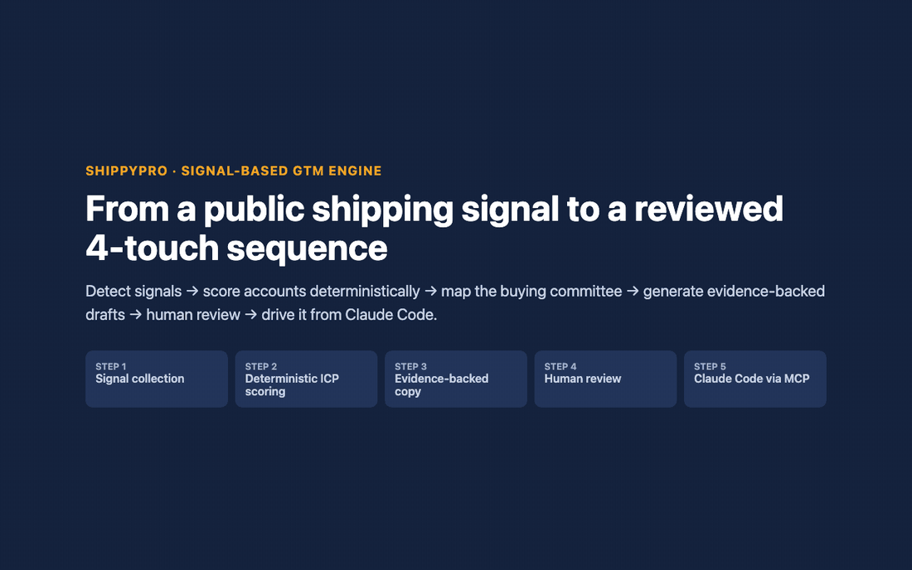
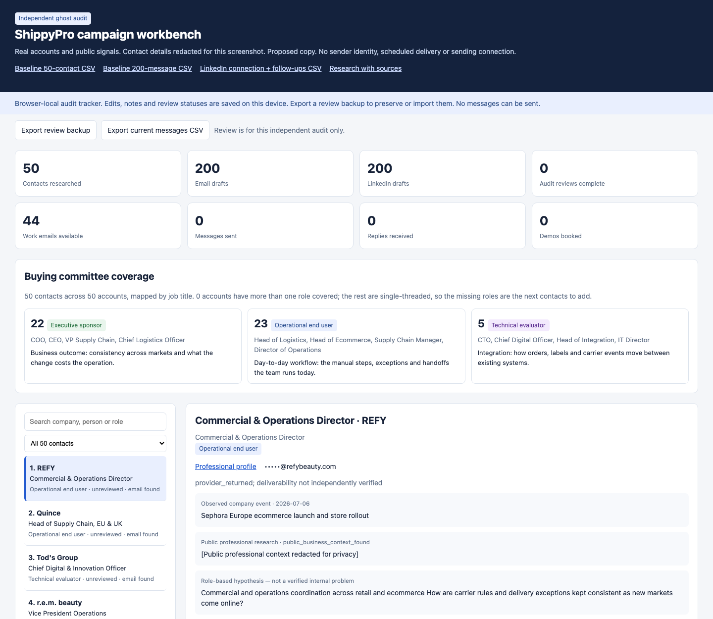
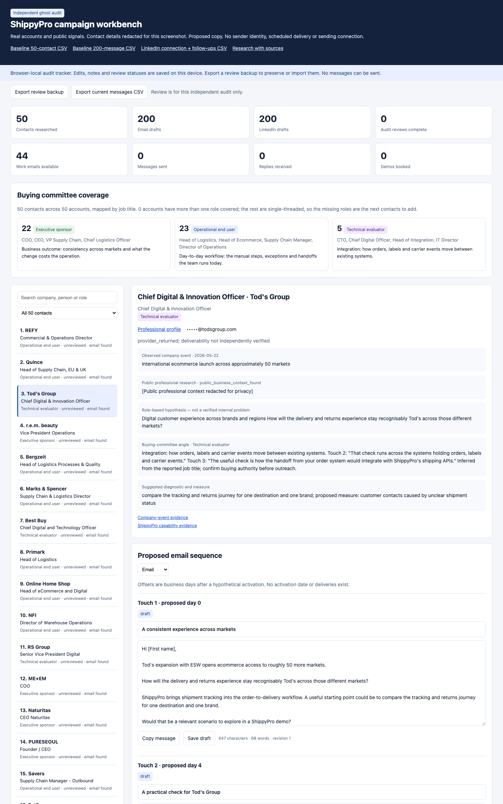
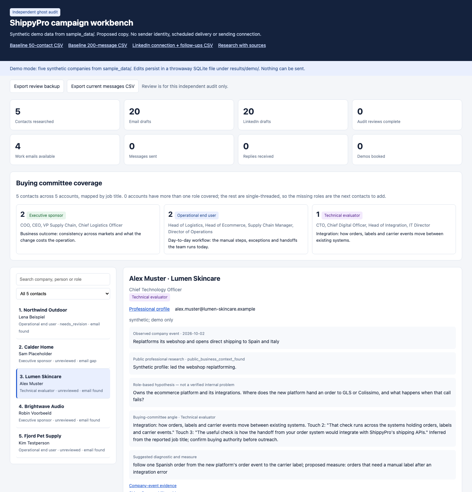
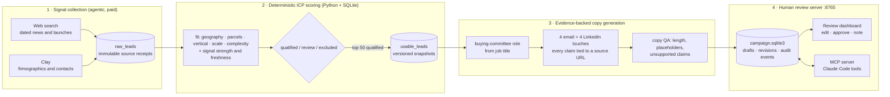

# ShippyPro Signal-Based GTM Engine

## Executive summary

An end-to-end, signal-based outbound engine built for ShippyPro. It finds public ecommerce shipping and checkout signals (market launches, new fulfilment hubs, carrier changes, replatformings), scores **100 target accounts** with deterministic ICP rules, enriches **50 decision-maker contacts** through Clay and web research, and serves **200 email drafts plus 200 LinkedIn drafts** in a zero-dependency, human-in-the-loop review dashboard.

Every claim in a draft points back to a source URL. Nothing is sent: the engine has no send transport, and every message waits for a human decision.

| | |
|---|---|
| Accounts scored | 100 (55 qualified, 29 for review, 16 excluded with a stated reason) |
| Contacts enriched | 50, one decision maker per selected account, 44 with a work email |
| Drafts | 4-touch email sequence + LinkedIn connection note and 3 follow-ups per contact |
| Buying-committee map | 22 executive sponsors, 23 operational end users, 5 technical evaluators |
| Dependencies | Python 3.10+ standard library and SQLite. No pip install. |

## Visual demo

<!-- Loom walkthrough: add the 3-minute recording link here once it is published. -->



[MP4 version](docs/images/workflow.mp4)



<details>
<summary>More screenshots</summary>

**Evidence and the 4-touch sequence for one account.** The role badge sets the angle of Touch 2 and Touch 3. Contact details are redacted.



**Demo mode on the synthetic sample data**, which is what a fresh clone runs.



</details>

### Try it in 10 seconds

```sh
git clone https://github.com/Excergic/shippyPro-gtm.git && cd shippyPro-gtm
python3 src/outbound_engine.py serve --demo
# open http://127.0.0.1:8765
```

Demo mode builds a throwaway workspace from [`sample_data/`](sample_data/): five synthetic companies on reserved `.example` domains, run through the same scoring fields, draft generator, copy QA and review API as the real campaign. Edits, notes and review decisions persist in `results/demo/` until the next start. No login, no network calls, and nothing can be sent.

## System architecture

The split is deliberate. LLMs and enrichment providers *collect and phrase*. Python *decides*, so a re-run gives the same answer and costs nothing.



| Stage | Code |
|---|---|
| Source discovery and contact collection | `src/signal_pipeline.py`, `src/icp_pipeline.py` |
| ICP scoring | `src/signal_assessment.py`, rules in `config/signal_first.example.json` |
| Two-table lead store | `src/lead_store.py`, `src/simple_lead_schema.sql`, `src/shippypro_db.py` |
| Copy generation and QA | `src/outbound_engine.py`, `src/linkedin_copy.py`, `src/buying_committee.py`, rules in `context/outbound/` |
| Review server and dashboard | `src/outbound_engine.py serve`, `src/outbound_dashboard.html` |
| Claude Code integration | `src/mcp_server.py`, `.mcp.json` |

## Multi-persona buying committee

Each contact is mapped to a buying-committee role from their job title (`src/buying_committee.py`). The role changes the angle of the sequence. Touch 1 is always the account's public signal, and Touch 4 always closes the loop. Touch 2 and Touch 3 are rewritten for the role:

| Role | Typical titles | Angle | Touch 2 framing | Touch 3 framing |
|---|---|---|---|---|
| **Executive sponsor** (22) | COO, CEO, VP Supply Chain, Chief Logistics Officer | Business outcome and operating cost | A number worth seeing at leadership level before scoping any change | Fit with current systems and carriers, without a replatforming project |
| **Operational end user** (23) | Head of Logistics, Head of Ecommerce, Director of Operations | Manual steps, exceptions and handoffs | A check the team can run on one real order this week | How the exceptions handled by hand would run instead |
| **Technical evaluator** (5) | CTO, Chief Digital Officer, Head of Integration | Systems integration | A check across the systems holding orders, labels and carrier events | How the order-system handoff integrates with ShippyPro's shipping APIs |

The current campaign is **single-threaded: one contact per account**. The dashboard shows this openly, and for every account it lists the roles that are still missing. Those missing roles are the next contacts to source, so each account can be worked by its executive, end user and technical evaluator together. The role is a title-based inference, and the dashboard tells the reviewer to confirm buying authority before outreach.

## Why custom Python/SQLite + Clay beats pure no-code

1. **Human edits are never overwritten.** Drafts live in `campaign.sqlite3` with a content hash, a revision number and an `edited` flag. A rebuild regenerates only untouched drafts, and a stale browser tab cannot overwrite a newer edit, because saves check the revision. A no-code table that recomputes a column would replace the reviewer's rewrite.
2. **Two tables separate evidence from decisions.** `raw_leads` keeps every scraped or provider record as an immutable receipt (`INSERT OR IGNORE`). `usable_leads` holds the promoted company and contact pair, with its scores, evidence and draft snapshot. Re-scoring writes a new snapshot without losing the source it came from.
3. **Freshness is tracked, not assumed.** Provider-returned emails are stored as `unverified`, rows carry `refresh_due_at`, and the whole set sits in `needs_refresh` until a deliverability check sets `last_verified_at`. A stale contact can't quietly look ready to send.
4. **Deterministic re-runs cost zero credits.** `python3 src/pipeline.py build --campaign` rebuilds every score and draft from saved receipts, without calling Clay, a search API or an LLM. Changing a scoring weight or a copy rule costs nothing, and the same inputs always give the same output, so changes can be reviewed and tested.

## Claude Code and MCP

`src/mcp_server.py` is a zero-dependency MCP server (stdio JSON-RPC) over the lead and campaign databases. `.mcp.json` registers it for Claude Code as `shippypro` (real workspace) and `shippypro-demo` (synthetic data).

| Tool | What it does |
|---|---|
| `get_top_scored_accounts(min_score, shipping_signal, country, limit)` | Ranks selected accounts from `usable_leads` by fit, then signal strength. `shipping_signal` is a text match on the public signal and its source, e.g. `DHL` or `launch`. |
| `inspect_account_evidence(company_name)` | Any of the 100 scored accounts: source event and URL, the 5-part fit breakdown, review flags, the contact's committee role and the current drafts. |
| `update_draft_status(contact_id, touch_number, new_copy, status)` | Rewrites one email or LinkedIn touch and/or sets the review status. It runs through the same revision checks and audit log as the dashboard, so the open dashboard shows the change on refresh. Nothing is ever sent. |

Example prompt with the demo server: *"Show me the top German prospects whose signal mentions DHL, inspect the best one, and rewrite Touch 2 for their role."*

Signals come from public news text. The databases hold no structured carrier or returns-portal fields, so filters such as "uses DHL" are matches on the signal and source text, not verified facts about the account's stack.

## Running the real workspace

Prospect datasets, contact details, provider receipts and SQLite databases stay local and are excluded from Git. A clone runs demo mode. Rebuilding the real campaign needs those private inputs.

Signal collection ran once through Clay and web search. Its receipts are saved under `results/signal_first_v3/raw/`, and every later step rebuilds from them.

```sh
python3 src/pipeline.py build              # rescore and resync leads from saved receipts
python3 src/outbound_engine.py build       # regenerate untouched drafts, keep edits
python3 src/outbound_engine.py serve       # review dashboard on http://127.0.0.1:8765
```

The review server listens on localhost only and has no login, so don't expose it on a public network. Copy and review commands are in [OUTBOUND_RUNBOOK.md](OUTBOUND_RUNBOOK.md). Scoring rules are in [RUNBOOK.md](RUNBOOK.md).

## Tests

```sh
python3 -m unittest discover -s tests -v
node tests/outbound_dashboard_state.cjs
```
